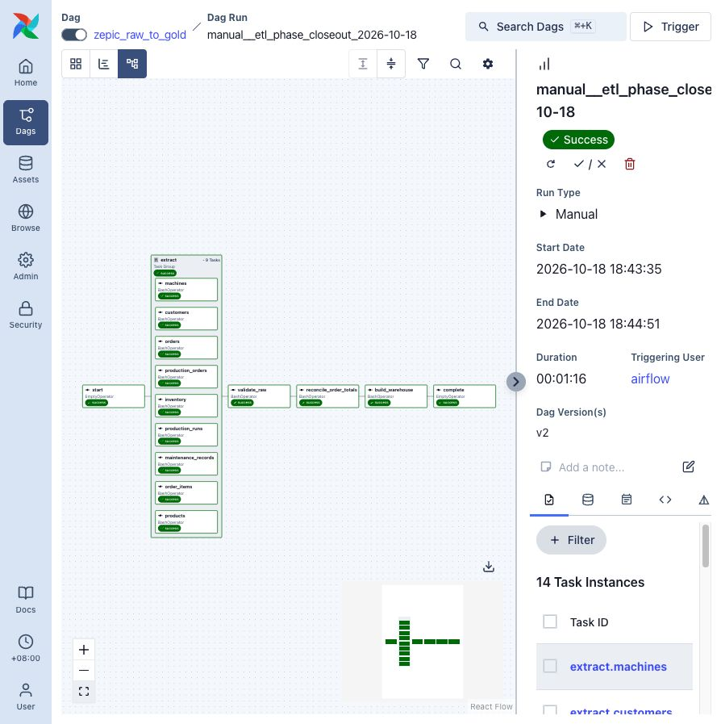
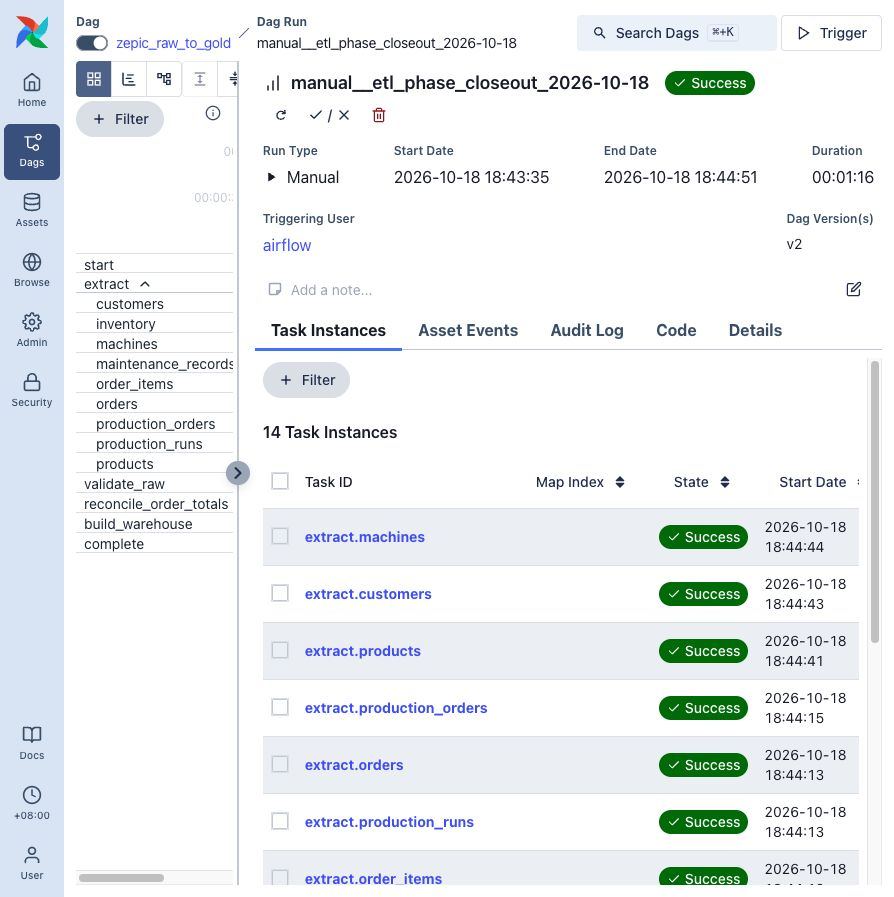
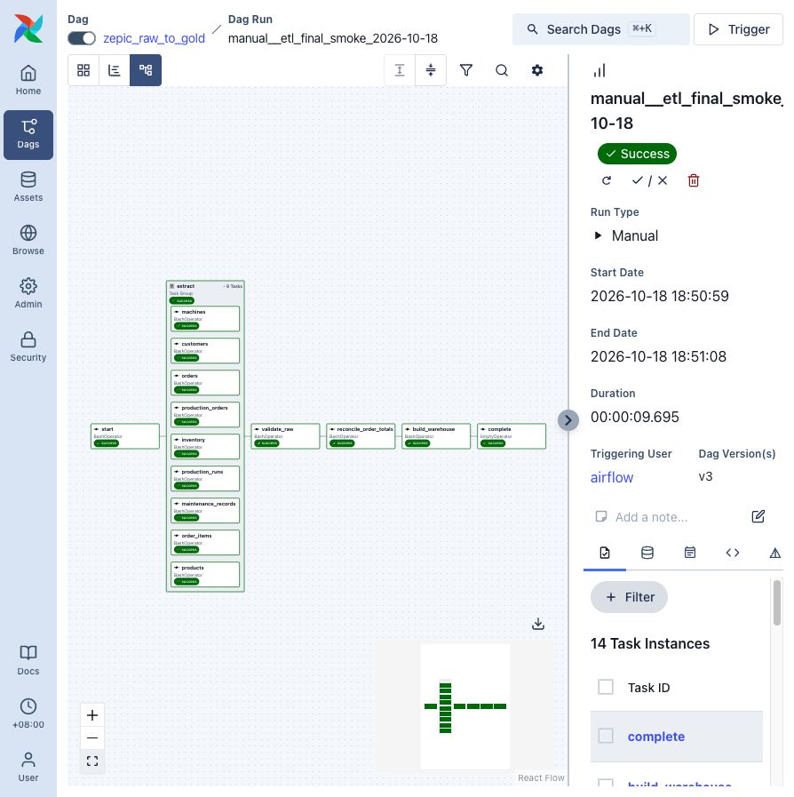
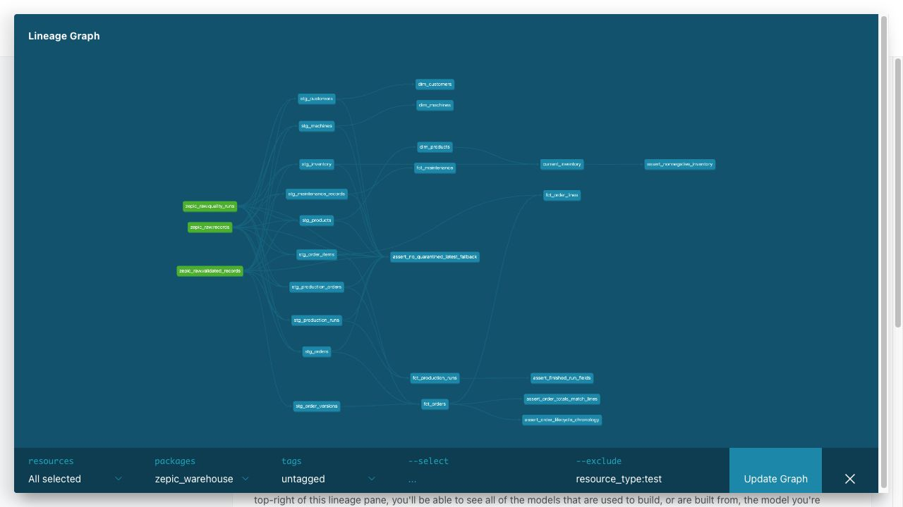

# ETL phase — design, operation and evidence

[Project README](README.md) | [中文项目说明](README.zh-CN.md) | [AI phase](AI_README.md)

The ETL phase owns everything from deterministic operational data generation to
tested Gold models. Airflow is a thin orchestration layer over the same Python
and dbt entry points that can be run directly.

## Data path

```text
Operational PostgreSQL
  -> allowlisted FastAPI source
  -> per-table incremental extraction
  -> append-only Raw versions + transactional watermarks
  -> versioned row-quality gate
  -> order-header/line reconciliation gate
  -> dbt physical Silver tables
  -> dbt analytical Gold tables
```

Airflow runs this as one manual `zepic_raw_to_gold` DAG. Nine extraction tasks
fan out with global parallelism four, then converge on validation,
reconciliation and the warehouse build. `max_active_runs=1` prevents concurrent
runs from advancing the same watermarks.

## Core contracts

### Simulation

Daily order generation and production/fulfilment run inside one outer
transaction per date. Preview mode does not write. `--resume` can skip complete
dates or finish the latest order-only date, but it is not a general job ledger;
retained history and configuration must remain consistent.

```sh
.venv/bin/python scripts/etl/generate_initial_data.py --apply
.venv/bin/python scripts/etl/run_simulation.py \
  --start-date 2026-01-02 --days 30 --resume --apply
```

### Incremental extraction and Raw

The source API exposes only the nine approved operational tables. Pages are
ordered by `(updated_at, primary key)` and bounded by a cursor captured at the
start of each table batch. Decimal values remain exact strings and timestamps
are UTC ISO-8601 values.

Each table commits Raw rows, batch metadata and its watermark in one transaction.
A failed table rolls back as a unit; successful sibling tables need not repeat.
Raw is append-only and replayable. This is current-state incremental extraction,
not CDC, and simulation writes should be paused while extraction runs.

### Quality gates

`validate_raw.py --fail-on-findings` applies versioned rules without modifying
Raw or watermarks. Invalid versions remain in Raw and are recorded in quarantine.
An empty retry cannot bypass a source key whose latest checked version is still
invalid.

`reconcile_order_totals.py --fail-on-findings` uses exact decimal arithmetic to
compare the latest eligible order headers with their current lines. Mismatches,
missing lines and quarantine-related skips block the warehouse build.

### Silver and Gold

dbt materializes ten Silver tables: nine typed current-state tables plus
`stg_order_versions`. It ranks the latest quality-checked Raw version first and
then applies validity, so a quarantined latest version suppresses the key instead
of silently restoring older data.

Gold contains three dimensions, four facts and current inventory:

| Model | Grain |
| --- | --- |
| `dim_customers`, `dim_products`, `dim_machines` | one row per current entity |
| `fct_orders` | one row per order |
| `fct_order_lines` | one row per order item |
| `fct_production_runs` | one row per production run |
| `fct_maintenance` | one row per maintenance record |
| `current_inventory` | one current row per product |

`stg_order_versions` contains observed valid versions, not a complete event log.
A missing lifecycle timestamp means the state was not observed. Current inventory
is not historical inventory. The removed `agg_daily_orders` model is intentionally
absent because grouping creation date by current status produced mutable history.

## Run the phase directly

```sh
docker compose up -d --wait postgres source-api
.venv/bin/python scripts/etl/extract_to_raw.py --table all
.venv/bin/python scripts/etl/validate_raw.py --fail-on-findings
.venv/bin/python scripts/etl/reconcile_order_totals.py --fail-on-findings
.venv/bin/python scripts/etl/run_warehouse.py build
```

Generate and serve dbt lineage locally:

```sh
.venv/bin/python scripts/etl/run_warehouse.py docs generate
.venv/bin/python scripts/etl/run_warehouse.py docs serve
```

## Airflow operation and recovery

```sh
docker compose build source-api airflow-scheduler
docker compose up --no-build --abort-on-container-exit \
  --exit-code-from airflow-init airflow-init
docker compose up -d --no-build \
  source-api airflow-apiserver airflow-scheduler airflow-dag-processor
```

Open <http://127.0.0.1:8080>. The DAG is manual and starts paused. Extraction
tasks retry twice at 30-second intervals; downstream quality and build tasks do
not retry automatically so data failures remain visible. Fix the cause and clear
only the failed and downstream task instances to resume the same run.

Stop services without deleting the database checkpoint:

```sh
docker compose stop \
  source-api airflow-apiserver airflow-scheduler airflow-dag-processor
```

Do not run `docker compose down --volumes` unless the entire operational and
warehouse checkpoint is intentionally disposable.

## Accepted evidence

The final refresh committed February 3, 2026; the next valid simulation date is
February 4, 2026.

| Layer | Accepted result |
| --- | ---: |
| Operational orders / order items | 3,468 / 10,334 |
| Completed production orders / runs | 610 / 610 |
| Shipped / pending orders | 3,342 / 126 |
| Available inventory units | 800 |
| Raw records / completed extraction batches | 15,551 / 72 |
| Quality findings | 0 |
| Reconciled orders | 3,468 matched, 0 issues |
| Gold orders / lines / production runs | 3,468 / 10,334 / 610 |

The Airflow closeout run `manual__etl_phase_closeout_2026-10-18` completed all
14 tasks. A later empty-increment smoke run completed all tasks on their first
attempt in 9.695 seconds after Raw schema setup was moved before the parallel
extract branches.







The dbt build covers 18 physical models and 93 data tests; all 111 resources
passed. Its generated lineage confirms the Raw-to-Silver-to-Gold dependency.



## Verification and boundaries

```sh
ZEPIC_DB_TESTS=1 .venv/bin/python -m unittest discover -s tests -v
.venv/bin/python scripts/etl/run_warehouse.py parse
.venv/bin/python scripts/etl/run_warehouse.py build
```

The ETL checkpoint passed 61 Python tests before the AI phase was added; the
current integrated suite contains 110. The project deliberately excludes CDC,
streaming, Spark, cloud deployment, partial fulfilment and complete event-history
claims.
